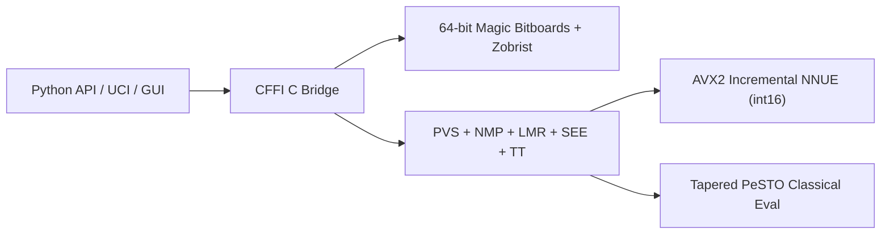

# Chess Engine (`castled`)

[](https://github.com/dakshgoel2008/castled_realms/actions/workflows/ci.yml)
[](https://lichess.org/@/CastledBot)

**CastledEngine** (`castled`) is a from-scratch **C99 + Python (CFFI)** chess engine and pip-installable library. It combines a 64-bit magic-bitboard move generator, Principal Variation Search (PVS), an incremental AVX2 SIMD neural network (**NNUE**), an end-to-end self-play training pipeline, a UCI server, and a 1200x768 Pygame GUI with post-game review.

---

## Under the Hood (Engineering Highlights)



- **64-Bit Magic Bitboards (`27.7M nodes/sec`)**: $O(1)$ sliding piece attack lookups using precomputed magic multipliers, copy-make/unmake state stack, and incremental 64-bit Zobrist hashing (`perft(6)` = 119M nodes in `4.29s`).
- **Principal Variation Search (Depth 14 in 1.0s)**: Iterative deepening with Aspiration Windows ($\Delta = 35$ cp), lockless-style Zobrist Transposition Table, Null-Move Pruning (with zugzwang guard), Late Move Reductions (LMR), Static Exchange Evaluation (SEE) capture ordering/pruning, Reverse Futility Pruning, Killer moves, and History heuristics (**+459 Elo** over baseline alpha-beta in SPRT).
- **Incremental `int16` NNUE Inference (`768 -> 256x2 -> 1`)**: Perspective-based neural network with Squared Clipped ReLU ($\text{clamp}(x, 0, 255)^2$) activation. White and Black accumulators update incrementally during `make_move`/`unmake_move` via **AVX2 SIMD** (`_mm256_add_epi16` / `_mm256_sub_epi16`).
- **Self-Play NNUE Training Pipeline**: Generates quiet self-play positions in a compact binary format (`CSDT`), trains with Adam + cosine annealing on a blended WDL + search-score sigmoid MSE loss, and quantizes weights to `int16` (`QA=255, QB=64`).
- **Polyglot Book & Desktop GUI**: $O(\log N)$ binary-searched `.bin` opening book prober and a 60 FPS Pygame interface featuring a live win-probability eval bar, PGN import/export, and automated Game Review (Blunder/Mistake/Best classification).

---

## Quick Start

### 1. Install
```bash
git clone https://github.com/dakshgoel2008/castled_realms.git
cd castled_realms
pip install -e ".[dev,gui]"
```

### 2. Use as a Python Library
```python
from castled import Board, Engine

board = Board()

with Engine(hash_mb=64, nnue=True, use_book=True) as engine:
    # Search for 0.5 seconds
    move = engine.best_move(board, time=0.5)
    board.push(move)

    # MultiPV analysis (top 3 candidate lines)
    for line in engine.analyse(board, depth=6, multipv=3):
        pv = " ".join(m.to_uci() for m in line.pv)
        print(f"#{line.multipv} | {line.score:+d} cp | depth {line.depth} | {pv}")
```

### 3. Run from the CLI
```bash
castled play               # Launch the 1200x768 Pygame GUI + Game Review
castled uci                # Start the UCI engine (for CuteChess, Arena, En Croissant)
castled perft --depth 6    # Verify move generation speed and accuracy
castled bench --depth 7    # Run tactical search benchmark
```

### 4. Run as a Lichess BOT
```bash
export LICHESS_TOKEN="lip_your_token_here"
python tools/lichess_bot.py --config tools/lichess-bot-config.yml
```
