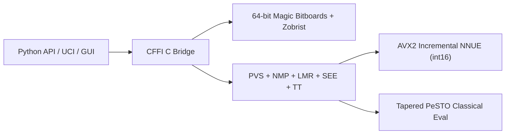

# CastledEngine (`castled`)

[](https://github.com/dakshgoel2008/Chess_Engine/actions/workflows/ci.yml)
[](https://lichess.org/@/CastledBot)

**CastledEngine** (`castled`) is a from-scratch **C99 + Python (CFFI)** chess engine and pip-installable library. It combines a 64-bit magic-bitboard move generator, Principal Variation Search (PVS), an incremental AVX2 SIMD neural network (**NNUE**), an end-to-end self-play training pipeline, a UCI server, and a 1200x768 Pygame GUI with post-game review.

---

## Strength

**About 2500 Elo (± 100, 95% interval)** against Stockfish 19 limited to fixed `UCI_Elo` levels, over 120 games at 100 ms per move with the classical evaluation:

| Stockfish UCI_Elo | 1500 | 1800 | 2100 | 2400 | 2700 | 3000 |
|---|---|---|---|---|---|---|
| CastledEngine score | 95% | 95% | 85% | 62% | 32% | 12% |

The [full report](docs/elo/README.md) lists the exact setup and the command to reproduce it, and [every game is saved as PGN](docs/elo/gauntlet.pgn). This is an estimate on Stockfish's scale, not a FIDE, CCRL or Lichess rating.

**Play it online:** challenge [@CastledBot on Lichess](https://lichess.org/@/CastledBot) to a timed game. Its Lichess ratings are on its profile once it has played rated games.

---

## Under the Hood (Engineering Highlights)



- **64-Bit Magic Bitboards (`27.7M nodes/sec`)**: $O(1)$ sliding piece attack lookups using precomputed magic multipliers, copy-make/unmake state stack, and incremental 64-bit Zobrist hashing (`perft(6)` = 119M nodes in `4.29s`).
- **Principal Variation Search (Depth 14 in 1.0s)**: Iterative deepening with Aspiration Windows ($\Delta = 35$ cp), lockless-style Zobrist Transposition Table, Null-Move Pruning (with zugzwang guard), Late Move Reductions (LMR), Static Exchange Evaluation (SEE) capture ordering/pruning, Reverse Futility Pruning, Killer moves, and History heuristics (**+459 Elo** over baseline alpha-beta in SPRT).
- **Incremental `int16` NNUE Inference (`768 -> 256x2 -> 1`)**: Perspective-based neural network with Squared Clipped ReLU ($\text{clamp}(x, 0, 255)^2$) activation. White and Black accumulators update incrementally during `make_move`/`unmake_move` via **AVX2 SIMD** (`_mm256_add_epi16` / `_mm256_sub_epi16`).
- **Self-Play NNUE Training Pipeline**: Generates quiet self-play positions in a compact binary format (`CSDT`), trains with Adam + cosine annealing on a blended WDL + search-score sigmoid MSE loss, and quantizes weights to `int16` (`QA=255, QB=64`).
- **Polyglot Book & Desktop GUI**: $O(\log N)$ binary-searched `.bin` opening book prober and a 60 FPS Pygame interface featuring a live win-probability eval bar, PGN import/export, and automated Game Review (Blunder/Mistake/Best classification).

---

## Play Against CastledEngine

You need **Python 3.10+** and a **C compiler**, because the engine core is compiled during install:

- **Windows**: [Visual Studio Build Tools](https://visualstudio.microsoft.com/visual-cpp-build-tools/) with the "Desktop development with C++" workload
- **macOS**: `xcode-select --install`
- **Linux**: `gcc` (e.g. `sudo apt install build-essential`)

```bash
python -m venv .venv
source .venv/bin/activate          # Windows: .venv\Scripts\activate
pip install "castled @ git+https://github.com/dakshgoel2008/Chess_Engine.git"
castled play
```

`castled play` opens the desktop GUI: choose to play White, Black, two-player, or watch AI vs AI, then use **G** for a post-game review. Options:

```bash
castled play --mode black --difficulty Hard
castled play --pgn my_game.pgn     # load / save a game
```

If the `castled` command is not found, run `python -m castled play` instead.

---

## Quick Start (Development)

### 1. Install
```bash
git clone https://github.com/dakshgoel2008/Chess_Engine.git
cd Chess_Engine
pip install -e ".[dev]"
```

### 2. Use as a Python Library
```python
from castled import Board, Engine

board = Board()

with Engine(hash_mb=64, nnue=True, use_book=True) as engine:
    # Search for 0.5 seconds
    move = engine.best_move(board, time=0.5)
    board.push(move)

    # MultiPV analysis (top 3 candidate lines)
    for line in engine.analyse(board, depth=6, multipv=3):
        pv = " ".join(m.to_uci() for m in line.pv)
        print(f"#{line.multipv} | {line.score:+d} cp | depth {line.depth} | {pv}")
```

### 3. Run from the CLI
```bash
castled play               # Launch the 1200x768 Pygame GUI + Game Review
castled uci                # Start the UCI engine (for CuteChess, Arena, En Croissant)
castled perft --depth 6    # Verify move generation speed and accuracy
castled bench --depth 7    # Run tactical search benchmark
```

### 4. Run as a Lichess BOT
1. Create a **new** Lichess account for the bot (it must not have played any games).
2. Logged in as that account, create a token at <https://lichess.org/account/oauth/token> with the **"Play games with the bot API"** (`bot:play`) scope.
3. Upgrade the account to a BOT (one-time and irreversible), then start the bot:

```bash
export LICHESS_TOKEN="lip_your_token_here"
python tools/lichess_bot.py --upgrade-account
python tools/lichess_bot.py --config tools/lichess-bot-config.yml
```

The bot accepts challenges that match `tools/lichess-bot-config.yml` (time controls, rated/casual, one game at a time) and stays online while the script runs. Challenge it from your normal account to test it.

To build a rating without playing it yourself, let it challenge other online BOTs near its rating (rated 3+2 by default, see the `matchmaking` section of the config):

```bash
python tools/lichess_bot.py --matchmaking
```

### 5. Estimate Elo offline against Stockfish
Plays a gauntlet against Stockfish limited to fixed `UCI_Elo` levels and fits one rating to all results:

```bash
sudo apt install stockfish        # or: brew install stockfish
python tools/elo_estimate.py --levels 1500 1800 2100 2400 --games 20 --movetime-ms 100
```
