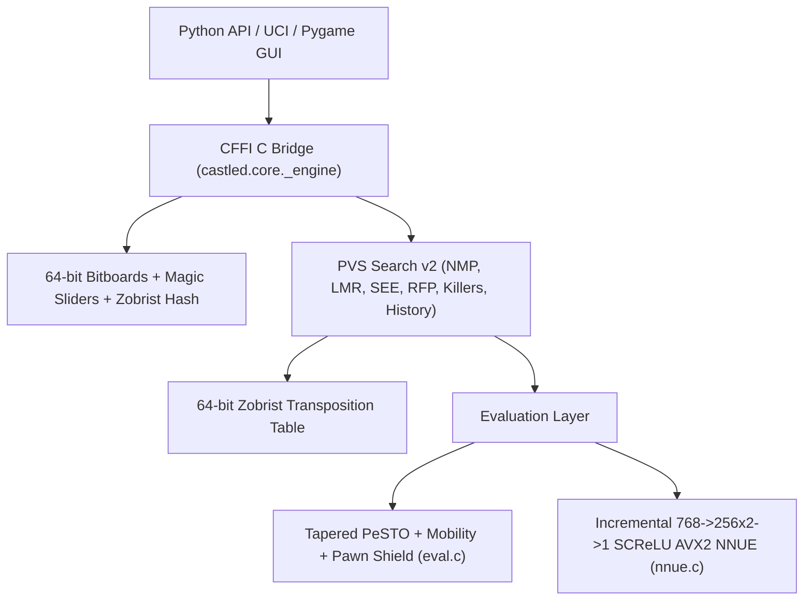

# Engine Architecture & NNUE

## System Overview

## Core Subsystems

1. **Bitboard Move Generator (`bitboard.c`, `magics.c`, `movegen.c`)**
   - Uses 64-bit occupancy bitboards (`uint64_t`) and fancy magic bitboards for $O(1)$ rook, bishop, and queen sliding attack lookups.
   - Reaches **27+ million nodes/sec** in Perft with zero Zobrist collisions.
2. **Search v2 (`search.c`, `tt.c`)**
   - Iterative deepening with Aspiration Windows ($\Delta = 35$ cp).
   - Principal Variation Search (PVS), Null-Move Pruning ($R = 2 + \text{depth}/4$) with non-pawn material zugzwang guard, Late Move Reductions (LMR), Static Exchange Evaluation (SEE) capture ordering and pruning, Reverse Futility Pruning (RFP), Futility Pruning (FP), Killer Moves (`2/ply`), and History Heuristic.
3. **Incremental NNUE (`nnue.c`, `nnue_ref.py`)**
   - `768 -> 256x2 -> 1` perspective network with `int16_t` weights (`QA=255`, `QB=64`, `SCALE=400`) and Squared Clipped ReLU (`clamp(x, 0, 255)^2`).
   - Incrementally updates White and Black accumulators inside `put_piece` and `remove_piece` using AVX2 SIMD (`_mm256_add_epi16` / `_mm256_sub_epi16`).

